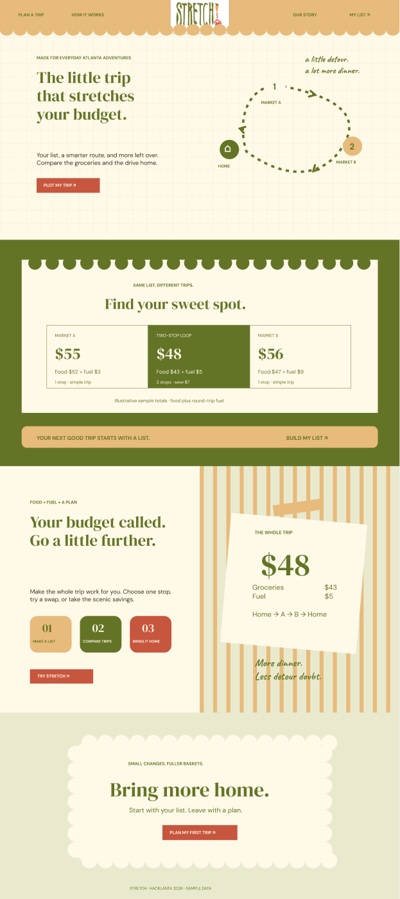

# Stretch

The cheapest groceries aren't always the cheapest grocery trip.

Stretch compares the cost of a whole grocery basket plus the fuel to get everything home.

## Project status

Hacklanta prototype. The current files are a static HTML/CSS/JavaScript prototype. The agreed implementation stack is **Next.js + Supabase**; migration and database integration are next.

## Selected design

**Draft C** is the selected direction. Preserve the original PNG logo and cream, olive, beige, and warm accent colors.

[Draft C in FigJam](https://www.figma.com/board/TNSW97eqDpo50behte9Xn9/Untitled?node-id=59-39)

## Run the current prototype

From this directory, run `python -m http.server 5173`, then open http://localhost:5173.

## Planned MVP

- Grocery list with quantities and dietary preferences.
- Budget, starting area, MPG, gas price, and maximum stops.
- Whole-basket and round-trip fuel comparison.
- One-store and two-store optimization with an item checklist per stop.
- Optional budget substitutions with quantity and savings explanations.
- Supabase tables for stores, products, offers, and price timestamps.

## Data limitations

Prices and distances in this prototype are illustrative sample data, not live store prices or navigation. Fuel estimates exclude tax and travel time. Do not present incomplete baskets as complete trip estimates.

## Configuration

Keep credentials in local environment files. Never commit Supabase secret or service-role keys.
